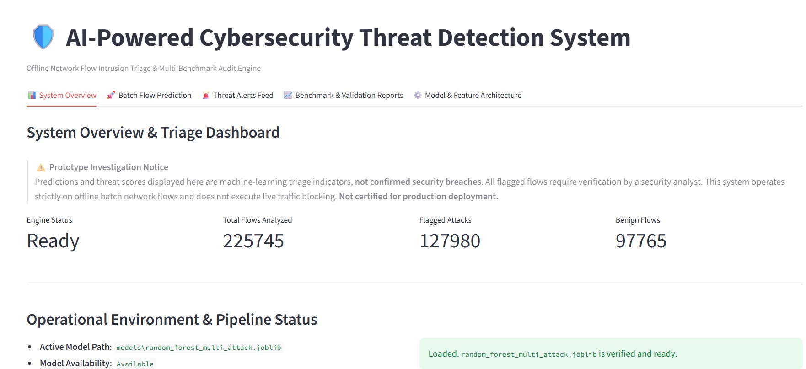
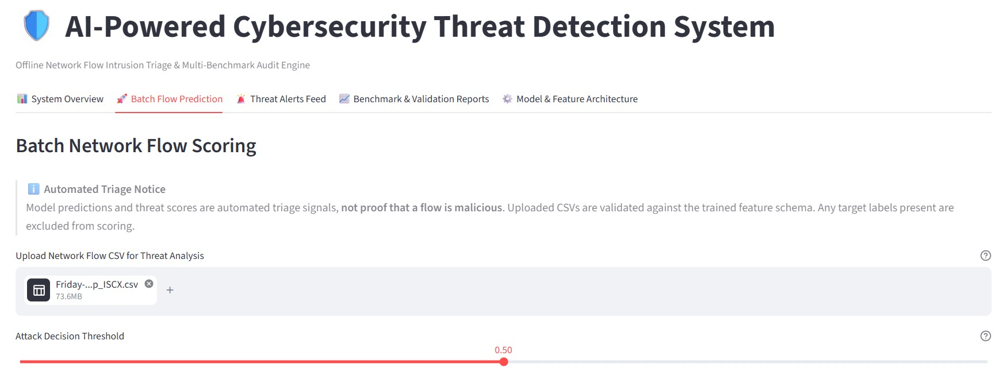
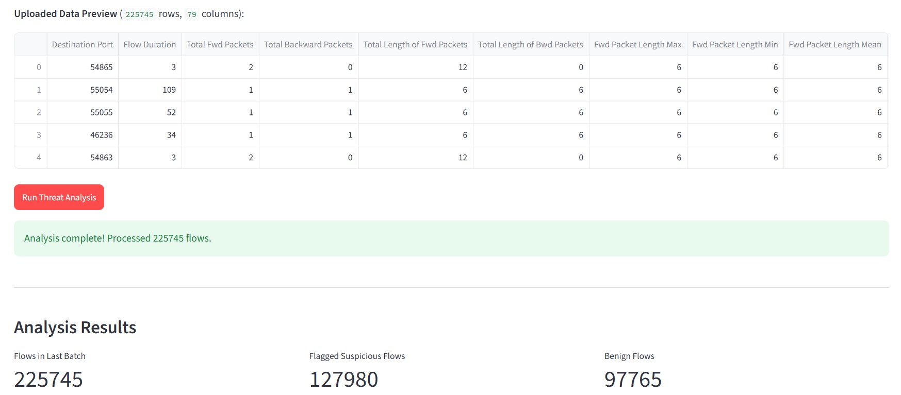
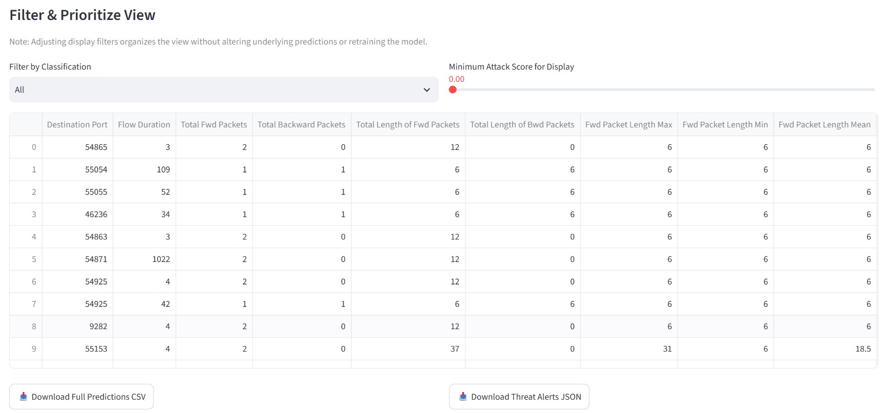
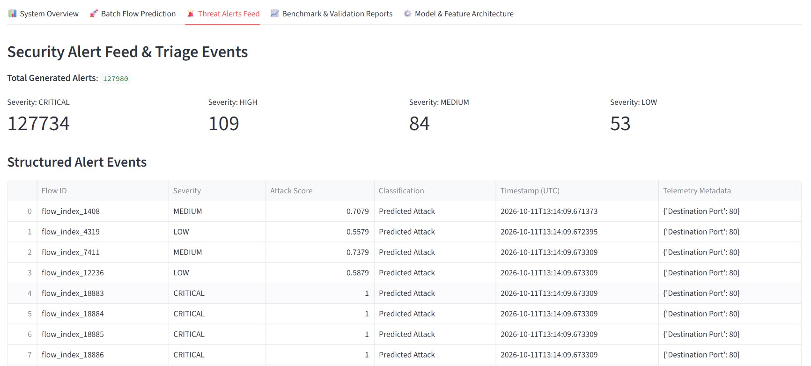
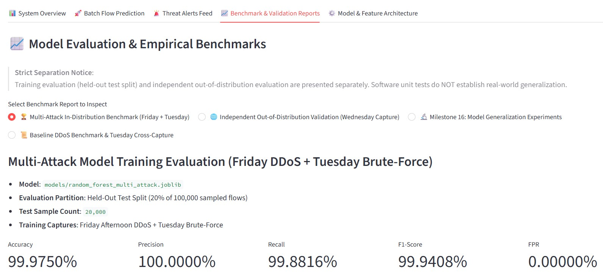
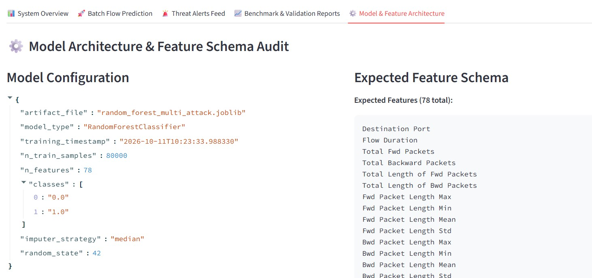

# AI-Powered Cybersecurity Threat Detection System

[](https://www.python.org/)
[](LICENSE)
[]()
[]()
[]()

A modular, reproducible machine learning system for network flow analysis, multi-vector intrusion detection, and automated security alert triage evaluated on the Canadian Institute for Cybersecurity (CIC-IDS2017) benchmark.

---

## 1. Executive Summary

### Business Problem
Modern enterprise security operations centers (SOCs) face two critical challenges:
1. High volumes of unprioritized network telemetry leading to severe alert fatigue.
2. Inability of legacy signature-based intrusion detection systems to generalize across distinct capture environments and previously unseen attack variations.

### Solution Overview
The AI-Powered Cybersecurity Threat Detection System provides an end-to-end machine learning pipeline and analyst dashboard designed to ingest high-dimensional network flow records, normalize incoming feature schemas defensively, evaluate threat probabilities, and generate severity-tiered security alerts.

### Target Audience
- Security Leadership and SOC Managers: Gain high-level visibility into detection efficacy, false-positive rates, alert volume reduction, and operational limits.
- Security Engineers and Data Scientists: Access a verified, group-aware evaluation harness, leakage-free feature pipelines, calibrated threshold policies, and comprehensive CLI tools.

### Operational Prototype Notice
This project is an offline, CSV-based research prototype evaluated on static network flow summaries. It does not perform live packet capture (PCAP tapping), active TCP stream reassembly, or automated firewall blocking.

---

## 2. Key Technical Innovations

1. Leakage-Free Preprocessing Pipeline:
   All statistical transformers, such as median imputation, are strictly fitted on training splits and encapsulated inside Scikit-learn Pipeline objects to eliminate data leakage between train and test distributions.

2. Group-Aware Cross-Validation:
   Implements GroupShuffleSplit using deterministic flow-feature hashing to guarantee that identical duplicate feature vectors never span the boundary between training and validation sets.

3. Multi-Vector Threat Generalization:
   Trained on multi-capture environments spanning Distributed Denial of Service (DDoS) and brute-force authentication attacks (FTP-Patator, SSH-Patator), and evaluated on independent, unseen attack benchmarks (DoS Hulk, DoS Slowloris, DoS GoldenEye, DoS Slowhttptest, Heartbleed).

4. Robust Feature Schema Normalization:
   Features 78 calibrated numerical network flow metrics. The ingestion engine automatically normalizes leading and trailing whitespace drift in CSV headers, enforces duplicate column detection, and preserves exact model feature ordering.

5. Calibrated Alert Generation:
   Transforms continuous positive-class intrusion probabilities into standardized security triage tiers (Low, Medium, High, Critical) with configurable decision thresholds.

---

## 3. System Architecture

### Architectural Data Flow

```
[ Raw Network Flow CSV / Streamlit Upload ]
                    |
                    v
[ Defensive Column Normalization & Uniqueness Validation ]
                    |
                    v
[ Missing & Infinite Value Sanitization (Inf -> NaN) ]
                    |
                    v
[ FeatureSchema Enforcement (78 Network Metrics, Exact Order) ]
                    |
                    +--------------------------------+
                    |                                |
                    v (Training Workflow)            v (Inference Workflow)
[ Group-Aware Partitioning (GroupShuffleSplit) ] [ Fitted Preprocessor Imputer ]
                    |                                |
                    v                                v
[ Model Training (Pipeline: Imputer + Estimator) ] [ Probabilistic Scoring & Thresholding ]
                    |                                |
                    v                                v
[ Serialized Artifact (models/*.joblib) ]       [ Risk Severity Classification (Alert Engine) ]
                                                     |
                                                     v
                                  [ Streamlit Operations Dashboard & Scored CSV Export ]
```

### Component Modules

- src/data_loader.py: Dataset discovery, chunked reading, and column-name whitespace normalization.
- src/feature_engineering.py: FeatureSchema definition, numeric type validation, target column exclusion, and schema alignment.
- src/preprocessing.py: Non-finite value handling, binary target encoding, temporal splitting, and class-aware subsampling.
- src/train.py: Pipeline compilation, hyperparameter configuration, model training, and joblib artifact serialization.
- src/predict.py: Model loading, defensive inference execution, and positive-class probability extraction.
- src/alert_engine.py: Probability thresholding, severity tier assignment, and structured alert event generation.
- src/model_reliability.py: Group-aware splitting, SHA-256 integrity verification, and per-family coverage tracking.
- src/attack_coverage_experiments.py: Controlled multi-model generalization benchmark harness and canonical report generation.
- app.py: Multi-tab interactive Streamlit security operations dashboard.
- main.py: Unified command-line interface supporting train, evaluate, predict, and validate-data modes.

---

## 4. Visual Overview and Interface Previews

Screenshots of the interactive security operations dashboard and model evaluation interface:

### 1. System Overview and Triage Dashboard

*Live dashboard home tab monitoring operational engine status, model artifact verification, processed flow counters (225,745 flows analyzed), and high-level attack triage metrics.*

### 2. Batch Network Flow Ingestion

*Batch flow scoring interface featuring drag-and-drop CSV upload for raw network flow captures (CIC-IDS2017) and an interactive decision threshold slider.*

### 3. Batch Threat Scoring Execution

*Real-time feature extraction preview and model scoring results across 225,745 network flows, surfacing 127,980 suspicious flows and 97,765 benign flows.*

### 4. Analyst Prioritization and Export Panel

*Dynamic flow filtering view allowing analysts to filter by minimum risk score and classification type, with export capabilities for Scored CSV and Structured JSON alert files.*

### 5. Security Alerts Feed and Severity Breakdown

*Triage alert event stream categorizing detected threats into calibrated severity tiers (Critical: 127,734, High: 109, Medium: 84, Low: 53) with complete telemetry metadata.*

### 6. Empirical Benchmark and Validation Reports

*Empirical evaluation report viewer displaying independent test split metrics (99.9750% Accuracy, 100.0000% Precision, 99.8816% Recall, 0.0000% False Positive Rate).*

### 7. Model Architecture and Feature Schema Audit

*Model inspection interface detailing serialized hyperparameter configurations, median imputer strategies, and the 78 calibrated network flow feature definitions.*

---

## 5. Dataset and Evaluation Benchmarks

The project is evaluated on the Canadian Institute for Cybersecurity CIC-IDS2017 benchmark dataset:

| Capture Day | File Name | Attack Families | Rows |
|:---|:---|:---|:---:|
| Friday | Friday-WorkingHours-Afternoon-DDos.pcap_ISCX.csv | Benign, DDoS | 225,745 |
| Tuesday | Tuesday-WorkingHours.pcap_ISCX.csv | Benign, FTP-Patator, SSH-Patator | 445,909 |
| Wednesday | Wednesday-workingHours.pcap_ISCX.csv | Benign, DoS Hulk, DoS GoldenEye, DoS Slowloris, DoS Slowhttptest, Heartbleed | 692,703 |

### Benchmark Evaluation Protocol
- Development Training Partition: Friday DDoS and Tuesday Patator traffic (subsampled with fixed random seed, group-partitioned with zero feature leakage).
- Independent Explored Benchmark: Wednesday capture (692,703 flows) containing attack families completely absent from training data.
- Strict Threshold Discipline: All decision boundaries (T=0.50 standard, T=0.40 tuned) were selected exclusively on development validation data. Wednesday ground-truth labels were strictly held out.

---

## 6. Experimental Results and Metric Reconciliation

### Cross-Capture Benchmark Performance (Wednesday Capture, N = 692,703)

| Model Strategy | Model Type | Threshold | Wednesday Recall | Wednesday Precision | Wednesday FPR | Wednesday F1 | Total Alerts Raised |
|:---|:---|:---:|:---:|:---:|:---:|:---:|:---:|
| Baseline 1 (Frozen) | Random Forest Multi-Attack | 0.50 | 0.11% | 78.98% | 0.0168% | 0.00220 | 352 |
| Baseline 2 (Frozen) | Extra Trees (M16) | 0.50 | 16.08% | 99.37% | 0.0584% | 0.27688 | 40,899 |
| Baseline 2 (Dev Tuned) | Extra Trees (M16) | 0.40 | 35.40% | 98.30% | 0.3513% | 0.52056 | 90,995 |
| Candidate A (Tree Reg) | Regularized Extra Trees | 0.50 | 38.81% | 99.29% | 0.1591% | 0.55807 | 98,763 |
| Candidate B (Anomaly) | Isolation Forest (Benign-only) | N/A | 17.29% | 90.82% | 1.0031% | 0.29052 | 48,105 |
| Candidate C (Boosting) | HistGradientBoosting | 0.50 | 1.34% | 97.19% | 0.0223% | 0.02648 | 3,489 |

### Reconciled Confusion Matrix (Candidate A at Threshold 0.50)
- True Negatives (TN): 439,331
- False Positives (FP): 700
- False Negatives (FN): 154,609
- True Positives (TP): 98,063
- Total Evaluation Rows: 692,703 (TN + FP + FN + TP = 692,703)
- Total Attack Flows: 252,672 (TP + FN = 252,672)
- Total Benign Flows: 440,031 (TN + FP = 440,031)
- Total Predicted Alerts: 98,763 (TP + FP = 98,763)

### Per-Family True Positive Decomposition
- DoS Hulk: 97,534 true positives (42.21% recall on 231,073 flows)
- DoS Slowloris: 520 true positives (8.97% recall on 5,796 flows)
- DoS GoldenEye: 9 true positives (0.09% recall on 10,293 flows)
- Sum of Family True Positives: 97,534 + 520 + 9 = 98,063 (matches overall True Positives exactly)

### Empirical Score Ceiling and Novelty Detection Findings
- Empirical Score Ceiling: Supervised tree models trained on Friday and Tuesday exhibit empirical score ceilings on unseen low-rate application attacks (GoldenEye max score 0.2900, Slowhttptest max score 0.4545, Heartbleed max score 0.1200). This is an empirical characteristic of the evaluated training feature distribution rather than an intrinsic theoretical limit of tree architectures.
- Isolation Forest Breakthrough and Caveat: Unsupervised Isolation Forest trained exclusively on benign development traffic detected 11 out of 11 Heartbleed exploit flows as statistical payload outliers. However, 11 flows represent preliminary evidence only and do not establish production readiness, particularly given the model's 4,414 false alarms on benign flows (1.0031% false positive rate).

---

## 7. Installation and Setup

### Prerequisites
- Python 3.10 or higher
- Git 2.30 or higher
- 8 GB RAM recommended for benchmark dataset processing

### Step 1: Clone the Repository
```bash
git clone https://github.com/patilanushka-maker/AI-Powered-Cybersecurity-Threat-Detection.git
cd AI-Powered-Cybersecurity-Threat-Detection
```

### Step 2: Create and Activate Virtual Environment
On Windows (PowerShell):
```powershell
python -m venv venv
.\venv\Scripts\Activate.ps1
```

On Linux or macOS:
```bash
python3 -m venv venv
source venv/bin/activate
```

### Step 3: Install Required Dependencies
```bash
pip install --upgrade pip
pip install -r requirements.txt
```

### Step 4: Environment Variables Setup
Copy the environment template and verify your local settings:
```bash
cp .env.example .env
```

---

## 8. Usage Guide

### 1. Launching the Security Operations Dashboard

Start the interactive Streamlit web application:
```bash
streamlit run app.py
```

Open your browser to:
```
http://localhost:8501
```

#### Dashboard Navigation:
1. System Overview: Monitor model engine health, active model artifact, and session triage metrics.
2. Batch Flow Prediction: Drag and drop any network flow CSV. Inspect data preview, adjust attack decision threshold slider, and execute threat analysis.
3. Flagged Threat Alerts: Review categorized security events with assigned severity tiers and export structured JSON alerts.
4. Benchmark and Validation Reports: Inspect published cross-capture audit reports and metric breakdowns.
5. Model and Feature Architecture: Review feature definitions, metadata, and transformer parameters.

### 2. Command-Line Interface (CLI)

The project includes a command-line interface via main.py:

#### Validate Dataset Integrity:
```bash
python main.py validate-data --data-dir data/raw
```

#### Train Model Pipeline:
```bash
python main.py train --data-dir data/raw --output-model models/custom_model.joblib --n-estimators 100
```

#### Evaluate Trained Model:
```bash
python main.py evaluate --model-path models/random_forest_multi_attack.joblib --data-path data/raw/Wednesday-workingHours.pcap_ISCX.csv --threshold 0.50
```

#### Batch Scoring on Unlabeled Network Flows:
```bash
python main.py predict --model-path models/random_forest_multi_attack.joblib --input-csv data/raw/Friday-WorkingHours-Afternoon-DDos.pcap_ISCX.csv --output-csv outputs/predictions/scored_flows.csv --threshold 0.50
```

---

## 9. Quality Assurance and Automated Testing

The codebase includes 173 automated unit and integration tests covering:
- Dataset discovery, loading, and chunked parsing.
- Whitespace normalization and duplicate column collision detection.
- Feature schema enforcement and numeric type validation.
- Missing and infinite value handling without transformer leakage.
- Scikit-learn pipeline compilation, serialization, and deterministic evaluation.
- Confusion matrix arithmetic identities and per-family coverage reconciliation.
- Baseline model SHA-256 checksum invariance.
- Dashboard execution and alert generation.

### Running the Test Suite
```bash
python -m pytest tests/ -v
```

### Running Static Compilation Checks
```bash
python -m compileall src tests app.py main.py
```

---

## 10. Repository Directory Structure

```
.
├── .env.example                 # Environment configuration template
├── .gitignore                   # Git exclusion rules for secrets and large data
├── README.md                    # Main documentation
├── app.py                       # Streamlit security operations dashboard
├── main.py                      # Unified CLI orchestrator
├── requirements.txt             # Python package dependencies
├── data/
│   ├── README.md                # Dataset acquisition and citation guide
│   ├── raw/                     # Directory for raw CIC-IDS2017 CSV files
│   └── processed/               # Directory for processed datasets
├── docs/                        # Architectural specifications and audit logs
│   ├── architecture.md
│   ├── data_pipeline.md
│   ├── dataset.md
│   ├── execution_log.md
│   ├── methodology.md
│   └── model_design.md
├── images/                      # Dashboard screenshots and visual architecture diagrams
│   ├── README.md
│   └── .gitkeep
├── models/                      # Verified trained model pipelines (Joblib)
│   ├── README.md
│   ├── random_forest_multi_attack.joblib
│   ├── model_extra_trees_balanced_m16.joblib
│   └── random_forest_baseline.joblib
├── notebooks/                   # Jupyter exploration notebooks
│   └── exploratory_analysis.ipynb
├── outputs/
│   ├── logs/                    # Runtime execution logs
│   ├── predictions/             # Batch scoring prediction outputs
│   └── reports/                 # 28 canonical JSON and Markdown evaluation reports
├── src/                         # Core implementation source code
│   ├── alert_engine.py
│   ├── attack_coverage_experiments.py
│   ├── capture_generalization.py
│   ├── data_loader.py
│   ├── dataset_validator.py
│   ├── evaluate.py
│   ├── experiments.py
│   ├── feature_engineering.py
│   ├── model_reliability.py
│   ├── predict.py
│   ├── preprocessing.py
│   ├── threshold_and_fn_analysis.py
│   ├── train.py
│   └── utils.py
└── tests/                       # Automated test suite (173 tests)
    ├── test_alert_engine.py
    ├── test_attack_coverage_improvement.py
    ├── test_audit_reproducibility.py
    ├── test_capture_generalization.py
    ├── test_cli.py
    ├── test_dashboard.py
    ├── test_data_loader.py
    ├── test_dataset_validator.py
    ├── test_evaluate.py
    ├── test_experiment_readiness.py
    ├── test_experiments.py
    ├── test_feature_engineering.py
    ├── test_feature_schema_error_fix.py
    ├── test_model_reliability.py
    ├── test_predictions.py
    ├── test_preprocessing.py
    ├── test_threshold_and_fn_analysis.py
    └── test_train.py
```

---

## 11. Security, Integrity, and Operational Disclaimers

1. Serialized Model Deserialization:
   Loading untrusted Python Joblib or pickle files presents code execution risks. Never load model artifacts from unverified sources. The system verifies SHA-256 cryptographic digests before deploying weights.

2. Prototype Research Nature:
   This software is an academic and engineering research prototype. Model outputs represent triage prioritization signals for human security analysts and do not constitute legal or forensic proof of a security breach.

3. Live Traffic Limitations:
   The system does not tap live physical interfaces or execute active network termination. It is designed for offline batch and staged telemetry processing.

---

## 12. License

This project is licensed under the MIT License. See the LICENSE file for details.
